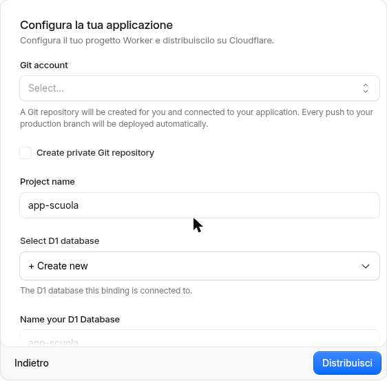
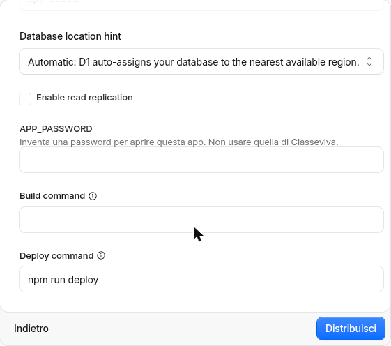
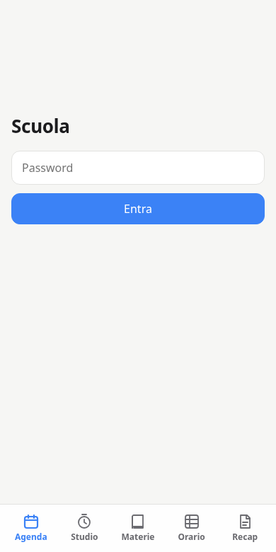
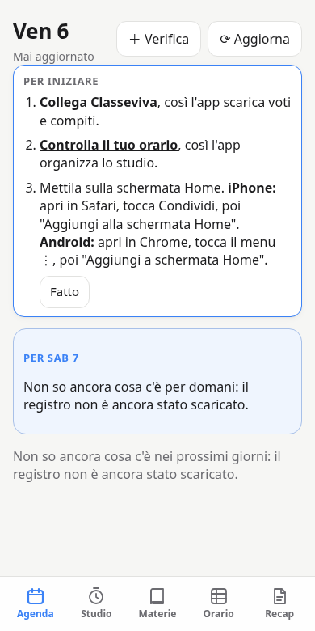
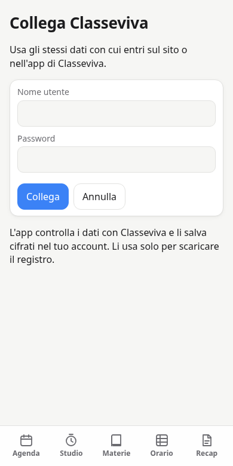
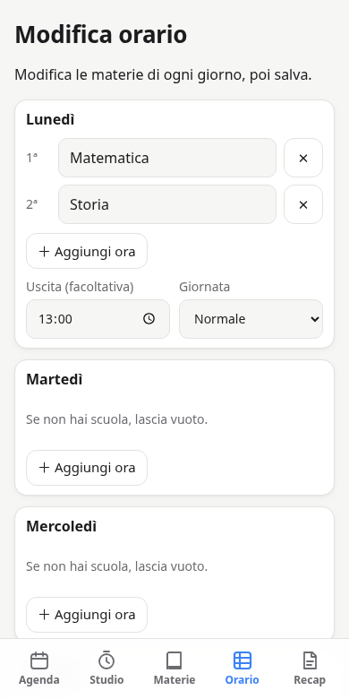
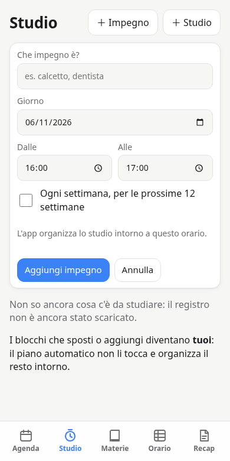

# Come installare App Scuola

Questa guida è per chi non ha esperienza con il computer. Non serve il terminale e non devi installare programmi. È gratis.

App Scuola è un progetto **non ufficiale**: non è di Classeviva né di Spaggiari. L'app sarà tua: starà nel tuo account e ci entrerai solo tu.

## Cosa ti serve

- Il nome utente e la password di **Classeviva**, gli stessi del registro.
- Un computer con Chrome, solo per l'installazione. Poi userai l'app anche dal telefono.
- Un'email tua, meglio se personale e non quella della scuola: se un giorno la scuola la disattiva, potresti perdere l'accesso all'app.

Se sei minorenne, fatti aiutare da un genitore: dovrai creare due account e accettare le loro condizioni d'uso.

## Parte 1: crea i due account

Se li hai già, passa alla Parte 2.

1. Crea un account gratuito su [github.com/signup](https://github.com/signup). Conterrà la copia dell'app.
2. Crea un account gratuito su [dash.cloudflare.com/sign-up](https://dash.cloudflare.com/sign-up). Farà funzionare l'app.
3. Apri la tua email e conferma entrambi gli account.

Queste pagine sono spesso in inglese. *Sign up* vuol dire "iscriviti".

## Parte 2: installa l'app

**Passo 1. Clicca il pulsante qui sotto.** Si apre Cloudflare. Se te lo chiede, accedi.

**Passo 2. Collega GitHub, la prima volta.** Clicca **New GitHub connection** e poi autorizza.

> ⚠️ **Se poi finisci su una pagina con "Hello World" e altre opzioni, non sceglierle.** È normale: torna a questa guida e clicca di nuovo il pulsante del Passo 1.

**Passo 3. Compila il modulo.** Il browser può tradurre parte della pagina, quindi alcune parole potrebbero essere diverse.

| Campo | Cosa fare |
|---|---|
| **Git account** | Scegli il tuo account GitHub |
| **Create private Git repository** | Metti la spunta |
| **Project name** | Lascia `app-scuola` |
| **Select D1 database** | Lascia **Create new** |
| **APP_PASSWORD** (*"Inventa una password per aprire questa app"*) | Inventa una password nuova |
| Tutto il resto | Non toccare nulla |

Parte alta del modulo:

Più in basso trovi la password:

> ⚠️ **Non usare la password di Classeviva in `APP_PASSWORD` e salvala subito in un posto sicuro.** Dopo non potrai rileggerla.

**Passo 4. Clicca Distribuisci** (o **Deploy**). Aspetta qualche minuto. A volte la pagina sembra ferma, ma è normale.

Quando vedi un segno di spunta verde, è finita.

**Passo 5. Trova l'indirizzo della tua app.** Nella pagina del progetto su Cloudflare c'è un indirizzo che finisce con `.workers.dev`. Aprilo e salvalo tra i preferiti.

> ⚠️ Non copiarlo dall'elenco di righe tecniche della pagina: il browser, traducendo, può cambiarne le lettere.

## Parte 3: primo avvio

**Passo 6. Entra.** Scrivi la password che hai inventato al Passo 3.

**Passo 7. Segui il riquadro "Per iniziare".**

**Passo 8. Collega Classeviva.** Tocca **Collega Classeviva** e scrivi i dati del registro. L'app li controlla e li salva cifrati nel tuo account.

**Passo 9. Controlla l'orario.** Tocca **Controlla il tuo orario**. Se l'app ha già scaricato le lezioni, lo propone da sola, ma può sbagliare: correggilo, poi tocca **Salva orario**. Se un giorno non hai scuola, lascialo vuoto.

**Passo 10. Mettila sul telefono.** Apri l'indirizzo della tua app sul telefono ed entra.

- **iPhone:** apri in Safari, tocca Condividi, poi "Aggiungi alla schermata Home".
- **Android:** apri in Chrome, tocca il menu ⋮, poi "Aggiungi a schermata Home".

Fatto! Da adesso la apri come una normale app.

## Ogni giorno

- **Agenda:** cosa c'è per domani, verifiche e interrogazioni.
- **Studio:** il piano di studio. Con **＋ Impegno** segni sport, corsi e altri impegni, anche ogni settimana, e il piano si organizza intorno.
- **Materie:** voti, medie e appunti. Con **＋ Aggiungi appunti** carichi foto e PDF.

I dati si aggiornano quando apri l'app. Se vuoi controllare subito, tocca **Aggiorna**.

## Se qualcosa non va

| Cosa vedi | Cosa fare |
|---|---|
| La pagina di Cloudflare resta bianca | Riprova più tardi: può essere un problema momentaneo di Cloudflare |
| L'installazione finisce con un errore rosso | Non usare "Retry build". Clicca di nuovo il pulsante del Passo 1 e scrivi un altro **Project name**, per esempio `app-scuola2`; in **Select D1 database** scegli **Create new** e scrivi lo stesso nome |
| "Identificativo o password errati" | Controlla i dati di Classeviva, oppure tocca **Correggi nome utente e password**. L'app non riprova da sola, per non far bloccare il tuo account |
| "Classeviva non risponde" | Il problema è passeggero: riprova più tardi |
| Hai dimenticato la password dell'app | Serve cambiarla su Cloudflare: fatti aiutare da qualcuno esperto |

## Sicurezza

- Non dare a nessuno la password dell'app, il tuo account Cloudflare o quello GitHub.
- Attiva la verifica in due passaggi su Cloudflare e GitHub: protegge anche i dati di Classeviva salvati nell'app.
- I tuoi voti stanno nel tuo account Cloudflare. L'autore del progetto non li vede.
- Per eliminare tutto, cancella da Cloudflare il progetto e il database e da GitHub la copia dell'app.
